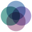

# Brand guidelines

Status: **Implemented** (design step 1, updated to Figma V3 in phase 2, see
[DD-34](DESIGN_DECISIONS.md#dd-34-figma-v3-tokens-typography-icons-and-brand-phase-2)). The masters are in
`design/svg/logo/`. The rules below are verified against those files.

## Essence

From design-instructions §1.1:

> IKIGAI ATLAS helps a person see their whole life, understand how goals connect, and make deliberate progress without
> being overwhelmed.

- **Attributes:** intentional, ambitious, intelligent, optimistic, premium, human, structured, calm.
- **Main tagline:** _See the whole. Shape what matters._ Use it in onboarding, app-store marketing and brand materials
  only, not on every screen.
- **Supporting line:** _Your life, mapped with purpose._

### Visual metaphor (§1.2)

Modern cartography, used sparingly:

| Product concept  | Cartographic meaning    |
| ---------------- | ----------------------- |
| The whole life   | The atlas               |
| Life Dimensions  | Regions                 |
| Destinations     | Meaningful outcomes     |
| Waypoints        | Milestones              |
| Steps            | Actionable tasks        |
| Connections      | Dependencies and impact |
| Journey Overview | Movement over time      |
| Milestone Awards | Meaningful progress     |

Route lines, waypoint dots, map-grid references and contour-like curves support hierarchy. They must never become
decorative noise.

## Logo anatomy

The symbol is the **cardinal Ikigai Venn** from the approved Figma V3 file
([DD-33](DESIGN_DECISIONS.md#dd-33-logo-symbol-is-the-figma-v3-cardinal-ikigai-venn)): four equal circles at the
cardinal points whose shared centre — ikigai — is formed by overlap only.

| Circle | Colour token                  | Geometry (64 × 64 viewBox) |
| ------ | ----------------------------- | -------------------------- |
| Top    | `brand-venn-blue` `#5685B5`   | centre (32, 20.8), r 19.2  |
| Left   | `brand-venn-teal` `#348F84`   | centre (20.8, 32), r 19.2  |
| Right  | `brand-venn-violet` `#8A73BB` | centre (43.2, 32), r 19.2  |
| Bottom | `brand-venn-rose` `#B17D9E`   | centre (32, 43.2), r 19.2  |

The drawn bounds are 1.6 → 62.4 on both axes, so the mark is centred. On light surfaces the circles use
`mix-blend-mode: multiply` at 72 % opacity; on dark surfaces `screen` at 82 %. Single-colour variants draw the circles
as outlines (Figma "Mono", stroke 1.28 on the 64 grid, inside the r 19.2 edge) so the overlaps stay visible.

**Wordmark:** "IKIGAI ATLAS" set in **Manrope Bold (700)**, 22/30 px with 1 px letter-spacing (Figma text style
`Atlas/V3/Wordmark`, token `typescale.wordmark`), and kept as **editable `<text>`** in every master. Never outline the
text in a master. If an outlined version is ever needed (print, or a raster that contains text), derive it as an export
(to verify whether this is needed).

## Variants

All files are in `design/svg/logo/`. Every file except the app icon and splash is also served by the web build at
`/brand/<file>`.

| File                                         | Size      | Use                                                                             |
| -------------------------------------------- | --------- | ------------------------------------------------------------------------------- |
| `ikigai-atlas-symbol.svg`                    | 64 × 64   | Default symbol on light surfaces                                                |
| `ikigai-atlas-symbol-on-dark.svg`            | 64 × 64   | Symbol on dark surfaces                                                         |
| `ikigai-atlas-symbol-monochrome.svg`         | 64 × 64   | Single colour via `currentColor`. Set the CSS `color`.                          |
| `ikigai-atlas-symbol-dimensions.svg`         | 64 × 64   | Fine-line outlines in the four Venn colours. **Marketing only, ≥ 48 px**.       |
| `ikigai-atlas-wordmark.svg`                  | 172 × 30  | Wordmark alone on light surfaces                                                |
| `ikigai-atlas-wordmark-on-dark.svg`          | 172 × 30  | Wordmark alone on dark surfaces                                                 |
| `ikigai-atlas-lockup-horizontal.svg`         | 232 × 48  | Default lockup: headers, documents, e-mail                                      |
| `ikigai-atlas-lockup-horizontal-on-dark.svg` | 232 × 48  | Horizontal lockup on dark surfaces                                              |
| `ikigai-atlas-lockup-stacked.svg`            | 172 × 138 | Centred compositions: splash-like layouts, about pages, social cards            |
| `ikigai-atlas-lockup-stacked-on-dark.svg`    | 172 × 138 | Stacked lockup on dark surfaces                                                 |
| `ikigai-atlas-monochrome.svg`                | 232 × 48  | Horizontal lockup in `currentColor` (embossing, single-ink print, theming)      |
| `ikigai-atlas-monochrome-on-light.svg`       | 232 × 48  | Monochrome lockup fixed to light text `#1D2935`                                 |
| `ikigai-atlas-monochrome-on-dark.svg`        | 232 × 48  | Monochrome lockup fixed to tide white `#F5F7FC`                                 |
| `ikigai-atlas-app-icon-master.svg`           | 1024²     | iOS, Play, PWA and social icon source: full-bleed tide space, symbol, no text   |
| `ikigai-atlas-app-icon-foreground.svg`       | 1024²     | Android adaptive-icon foreground (transparent)                                  |
| `ikigai-atlas-splash.svg`                    | 2732²     | Native splash source: tide space with the centred symbol                        |
| `favicon.svg`                                | 64 × 64   | Browser favicon. Switches to on-dark colours with `prefers-color-scheme: dark`. |

In the Angular app, use the `<atlas-logo>` component rather than an `` of these files
([COMPONENT_CATALOG](COMPONENT_CATALOG.md#atlas-logo)). It inlines the symbol, renders the wordmark as live text and
follows the active theme (`[data-theme='dark']`) automatically; there is no `tone` input.

## Clear space

Let **X = ¼ of the symbol's height**. For example, X is 8 px for a 32 px symbol and 12 px for the 48 px symbol in the
horizontal lockup.

- Keep at least **X** of empty space on all sides of the symbol or lockup. No text, edges or other marks may enter it.
- The symbol masters include 1.6/64 of padding around the drawn mark, and that padding counts towards X.
- In the horizontal lockup, the gap between symbol and wordmark is fixed by the master (48 px symbol, 12 px gap, text
  starts at x = 60). Do not change it.

## Minimum sizes

The symbol sizes were checked by rendering the masters with sharp/librsvg at the listed sizes and inspecting them at
1× and at zoom. The wordmark and lockup minimums follow from the Figma V3 master proportions (wordmark type = 22/30 of
the wordmark height, 22/48 of the horizontal lockup height and 22/138 of the stacked lockup height); re-check them by
rendering (to verify).

| Asset                                     | Minimum                                      | Finding                                                                                                             |
| ----------------------------------------- | -------------------------------------------- | ------------------------------------------------------------------------------------------------------------------- |
| Symbol, full colour                       | **24 px** in UI. 16 px for favicon/tab only. | At 16 px the four circles and the light/dark centre stay recognisable. 24 px reads clearly. 32 and 48 px are clean. |
| Symbol, monochrome                        | **24 px**                                    | At 16 px the outlined overlaps close up                                                                             |
| Symbol, fine-line colour                  | **48 px**, marketing only                    | The thin coloured outlines are weak on white below 48 px                                                            |
| Wordmark                                  | **18 px high** (≈ 13 px type)                | Smaller sizes lose the letter shapes                                                                                |
| Horizontal lockup                         | **32 px high**. Absolute minimum 24 px.      | The wordmark is about 15 px at 32 px and 11 px at 24 px. Below that it becomes illegible.                           |
| Stacked lockup                            | **80 px high**                               | At 56 px the wordmark is about 9 px. 80 px keeps it at about 13 px.                                                 |
| `<atlas-logo>` (`size` input = symbol px) | 24                                           | The default is 32. The wordmark renders at 22/48 (≈ 0.458) × size.                                                  |

## Colour usage

| Element                        | On light (page `#F5F7FA` or white)   | On dark (tide space or indigo)     | Single colour          |
| ------------------------------ | ------------------------------------ | ---------------------------------- | ---------------------- |
| Symbol circles                 | Venn colours, multiply, 72 % opacity | Venn colours, screen, 82 % opacity | `currentColor` outline |
| Wordmark                       | light text `#1D2935`                 | tide white `#F5F7FC`               | `currentColor`         |
| App icon and splash background | n/a                                  | tide space `#0B1020`               | n/a                    |

- Approved backgrounds are the V3 surfaces of either theme: light page `#F5F7FA`, white cards and navigation, and
  dark tide space `#0B1020`, indigo `#151B35` and navy `#202A46`. In the app, use the semantic surface tokens; the
  full palette is in [docs/design/design-tokens.md](../docs/design/design-tokens.md).
- On photography or busy backgrounds, use the monochrome variant on a solid panel.
- The Venn colours belong to the logo only. Never use them to convey meaning in the UI.

## Typography pairing

| Role                           | Typeface                                  | Notes                                                                                |
| ------------------------------ | ----------------------------------------- | ------------------------------------------------------------------------------------ |
| Wordmark, display and headings | **Manrope** (variable)                    | Wordmark, display and h1 are 700; h2–h4 are 600. Never for dense data or small text. |
| Body, labels, controls, data   | **Inter** (variable, weights 400/500/600) | Controls are 600. Use tabular numerals for metrics, dates and money.                 |
| Code and IDs                   | System monospace stack                    |                                                                                      |

## Do and don't

**Do**

- Use the supplied masters or `<atlas-logo>`, scaled proportionally.
- Use the on-dark variant on dark surfaces, and the monochrome variant when only one ink is available.
- Keep the clear space and the minimum sizes.
- Keep the wordmark as **IKIGAI ATLAS** in capitals and set in Manrope 700.

**Don't**

- Recolour, reorder or resize the circles.
- Rotate the mark. Blue is always on top.
- Add a shape in the shared centre; it is formed by overlap only.
- Remove circles. There are always four.
- Add effects: shadows, gradients, glows or 3D.
- Place the full-colour mark on mid-tone or patterned backgrounds.
- Stretch or condense the mark, or change the wordmark's 1 px letter spacing.
- Write the name differently, for example "Ikigai Atlas", "IKIGAIATLAS" or "Atlas" alone as the logo. "Atlas" is
  allowed as the PWA `short_name`.
- Put text inside the app icon.
- Use emoji or other icon sets next to the mark.

## App icon, splash and favicon rules

- **App icon master:** a 1024 × 1024 full-bleed, opaque tide-space (`#0B1020`) square. The symbol sits in a centred
  800 px box with a 112 px inset (enlarged from the Figma 640/192 master for optical parity with system icons). There is one dark master; the Figma light variant (`#F5F7FA`
  background) is not exported.
  - It contains no text.
  - It has no rounded corners, because the platforms apply their own masks.
  - It has no transparency, which iOS App Store requires.
- **Android adaptive icon:**
  - **Foreground:** `app-icon-foreground.svg` is a transparent 1024 px canvas (= 108 dp). The mark radius of about
    304 px stays inside the 66 dp safe circle (radius about 313 px).
  - **Background:** solid `#0B1020`.
- **Splash:** a 2732² tide-space square with the symbol only, centred at about 29 % of the width. Light and dark splash
  share one dark source and are currently identical.
- **Favicon:** `favicon.svg` is the vector icon and adapts to `prefers-color-scheme`. `favicon.ico` contains 16, 32 and
  48 px PNGs for legacy browsers. At 16 px the mark is a recognisable silhouette, not a detailed logo.
- **PWA and touch icons:** 180, 192 and 512 px rasters come from the app-icon master. See
  [ASSET_EXPORTS.md](ASSET_EXPORTS.md).

## Licensing

| Asset                                           | Licence                   | Notes                                                                                  |
| ----------------------------------------------- | ------------------------- | -------------------------------------------------------------------------------------- |
| IKIGAI ATLAS logo masters                       | Project-owned             | Original geometry, no third-party artwork                                              |
| Inter (`@fontsource-variable/inter` 5.3.0)      | SIL Open Font License 1.1 | Self-hosted. The licence permits bundling in apps.                                     |
| Manrope (`@fontsource-variable/manrope` 5.3.0)  | SIL Open Font License 1.1 | © 2019 The Manrope Project Authors. Self-hosted variable font; Atlas uses 600 and 700. |
| Tabler Icons (`@tabler/icons(-angular)` 3.51.0) | MIT, © Paweł Kuna         | Used for UI icons and the seven dimension SVGs. Attribution is a comment in each SVG.  |

Masters that contain text name their font dependency in an SVG comment ("Manrope Bold 700, 22/30, +1 px tracking, SIL
OFL 1.1"). Rendering a master on a machine without Manrope falls back to Inter or a system sans, so the width can
differ slightly. The current raster exports contain no text, so they do not depend on Manrope.
