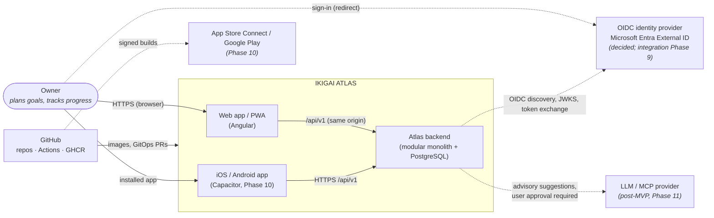
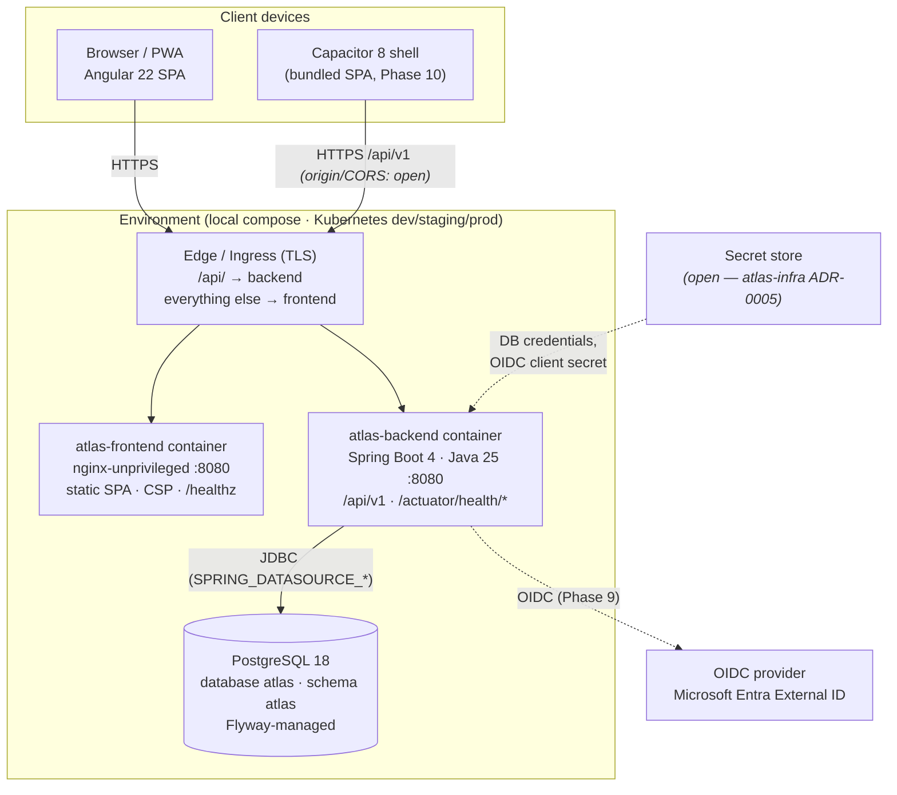
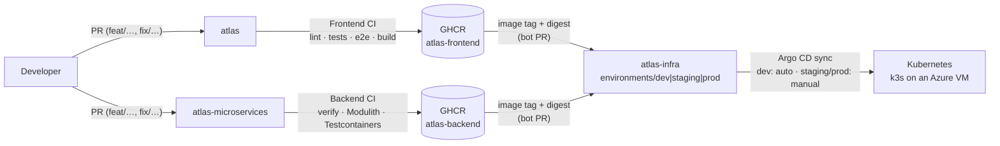

# IKIGAI ATLAS — system context, containers and repository ownership

- Status: Phase 0 baseline for owner review, 2026-11-12
- Owner: `atlas` repository (cross-repository document)
- Related: [ADR-0002 repository topology](../adr/0002-repository-topology-and-ownership.md) ·
  [IMPLEMENTATION-ROADMAP](../plan/IMPLEMENTATION-ROADMAP.md) ·
  `atlas-microservices/docs/architecture/DOMAIN-MODULES.md` · `atlas-microservices/docs/architecture/API-CONTRACT.md` ·
  `atlas-infra/docs/plan/PLAN-INFRASTRUCTURE-CICD.md`

Elements marked _(open)_ depend on decisions that are still `Proposed`. See the end of this document; rows there marked **decided** were accepted by the owner on 2026-11-12.

## 1. System context

Atlas is a private planning application for one owner at first. Owner boundaries are kept in the data model so that
more users can be added later without a redesign (`project-instruction.md` §21.12).

| External system                                    | Purpose                                                                                                         | Status                                                                                         |
| -------------------------------------------------- | --------------------------------------------------------------------------------------------------------------- | ---------------------------------------------------------------------------------------------- |
| OIDC identity provider                             | Sign-in. Proposed: BFF session for the web, PKCE system browser for Capacitor (`atlas-microservices` ADR-0005). | Microsoft Entra External ID, decided 2026-11-12; needed before any public deployment (Phase 9) |
| GitHub                                             | Source, pull requests, Actions CI, GHCR images, Dependabot                                                      | in use (repositories created)                                                                  |
| Kubernetes environments (`dev`, `staging`, `prod`) | Run the containers through Argo CD                                                                              | k3s on one Azure VM, decided 2026-11-12 (`atlas-infra` ADR-0003, ADR-0009); region _(open)_    |
| App Store Connect / Google Play                    | Mobile distribution                                                                                             | Phase 10                                                                                       |
| LLM / MCP provider                                 | Planning suggestions; never executes without explicit approval (§8)                                             | post-MVP                                                                                       |

## 2. Containers (runtime view)

| Container      | Owner repo                                               | Technology                                                                                | Contract                                                                                                                                                                                                                                                   |
| -------------- | -------------------------------------------------------- | ----------------------------------------------------------------------------------------- | ---------------------------------------------------------------------------------------------------------------------------------------------------------------------------------------------------------------------------------------------------------- |
| Frontend       | `atlas`                                                  | Angular 22 build served by `nginxinc/nginx-unprivileged:1.30-alpine`                      | Port 8080, non-root (uid 101); SPA fallback to `index.html`; `GET /healthz` → 200; hashed assets `immutable`, `index.html` `no-cache`; strict CSP (`script-src 'self'`); `/api/*` → 404 in the frontend container (the edge must route it)                 |
| Backend        | `atlas-microservices`                                    | Spring Boot 4 modular monolith (Spring Modulith), Java 25; versions in the backend notice | Port 8080; API under `/api/v1`; `/actuator/health`, `/liveness`, `/readiness`, `/info` only; config `SPRING_PROFILES_ACTIVE` (`local`, `dev`, `staging`, `prod`) and `SPRING_DATASOURCE_URL`/`_USERNAME`/`_PASSWORD`; structured JSON logs outside `local` |
| Database       | `atlas-microservices` (schema) · `atlas-infra` (hosting) | PostgreSQL 18 (`postgres:18.6-alpine` locally)                                            | Database, user and schema `atlas`; `public` unused; migrations only through Flyway; hosting: Azure Database for PostgreSQL Flexible Server B1ms, non-prod and prod servers (`atlas-infra` ADR-0004)                                                        |
| Edge / Ingress | `atlas-infra`                                            | `nginx:1.30-alpine` locally; Kubernetes Ingress in clusters                               | Same-origin routing, so the web needs no CORS and the BFF session cookie can work; TLS termination in clusters                                                                                                                                             |

**Same-origin rule.** The SPA calls relative URLs (`/api/v1/...`). No API host is compiled into the bundle, and one
image runs in every environment. `ng serve` mirrors this with `proxy.conf.json` (`/api` → `http://localhost:8080`).

## 3. Delivery view

- Images are immutable (tag plus digest). The same digest is promoted `dev` → `staging` → `prod` through reviewed PRs
  (`atlas-infra` ADR-0007, proposed). Image publishing to GHCR is not enabled yet. The container workflows currently
  build and smoke-test only.
- Database migrations must be backward compatible across a deployment window (expand/contract, §16.4). How they are
  executed is `atlas-infra` ADR-0008 (proposed).

## 4. Local development topologies

| Mode                     | How                                                                                                                                                                 | Ports            |
| ------------------------ | ------------------------------------------------------------------------------------------------------------------------------------------------------------------- | ---------------- |
| Frontend only (today)    | `atlas`: `npm start`                                                                                                                                                | 4200             |
| Frontend + backend       | `atlas-microservices`: `./mvnw spring-boot:run` (starts PostgreSQL from its `compose.yaml` via `spring-boot-docker-compose`); `atlas`: `npm start` (proxies `/api`) | 4200, 8080, 5432 |
| Full stack in containers | `atlas-infra`: `docker compose -f local/compose.yaml up --build` (builds both Dockerfiles from sibling checkouts, adds an `edge` nginx like the Ingress)            | 8000 (edge)      |

Local credentials (`atlas`/`atlas`) are throwaway values, bound to `127.0.0.1`, and never used outside local and tests.

## 5. Repository ownership

| Concern                                                                            | `atlas`                   | `atlas-microservices`       | `atlas-infra`                             |
| ---------------------------------------------------------------------------------- | ------------------------- | --------------------------- | ----------------------------------------- |
| UI, design system, brand assets, Capacitor                                         | **owns**                  | —                           | —                                         |
| Domain modules, API contract (OpenAPI), Flyway migrations                          | consumes the API contract | **owns**                    | —                                         |
| Container images                                                                   | builds `atlas-frontend`   | builds `atlas-backend`      | references tags and digests               |
| Environments, Ingress, Argo CD, secrets wiring, runbooks                           | —                         | —                           | **owns**                                  |
| Cross-repo docs: this file, roadmap, dependency/license matrix, cross-cutting ADRs | **owns**                  | links                       | links                                     |
| Plans                                                                              | PLAN-FRONTEND             | PLAN-BACKEND, PLAN-DATABASE | PLAN-INFRASTRUCTURE-CICD, COST-COMPARISON |

## 6. Trust boundaries and data

- **Data sensitivity:** goals, finances, health, relationships. Privacy by default (§1.1-8, §13); collect only what has
  an explicit use.
- **Browser:** holds no secrets and no tokens in Web Storage (§0.4). The proposed web session is an HttpOnly, Secure,
  SameSite cookie issued by the backend (BFF).
- **Native:** system-browser login with PKCE; tokens in platform secure storage. The plugin choice is open (§21.9).
- **Backend:** the only component that reaches the database or the IdP's token endpoint. It enforces owner-level
  authorization on every query (Phase 3).
- **Secrets:** never in Git. Local throwaway values only. Clusters use a secret store _(open)_.
- **Edge:** TLS and same-origin routing. In clusters the Ingress exposes only `/api` and `/`, so actuator endpoints
  are reachable only inside the cluster (probes). The local edge also proxies `/actuator/health` as a convenience. The
  frontend image works with a read-only root filesystem, all capabilities dropped and `no-new-privileges`. It needs
  writable `/tmp` and `/var/cache/nginx` (emptyDir), verified on 2026-11-12.

## 7. Decisions affecting this context

| # (§21) | Decision                                                                                               | Where                                             | Decision or recommended default                                                                                      |
| ------- | ------------------------------------------------------------------------------------------------------ | ------------------------------------------------- | -------------------------------------------------------------------------------------------------------------------- |
| 1, 9    | Identity provider; native login and secure storage                                                     | `atlas-microservices` ADR-0005                    | IdP **decided**: Microsoft Entra External ID; provider-neutral OIDC; BFF session (web); PKCE system browser (native) |
| 2       | Kubernetes platform and region                                                                         | `atlas-infra` ADR-0003, ADR-0009, COST-COMPARISON | platform **decided**: k3s on one B2as_v2 VM (prod as a namespace); region Germany West Central (proposed)            |
| 3, 11   | Database hosting, backup/restore, RPO/RTO                                                              | `atlas-infra` ADR-0004                            | hosting **decided**: Flexible Server B1ms, two servers; backup values see infra ADR                                  |
| 4       | Frontend hosting                                                                                       | `atlas-infra` ADR-0006                            | nginx container behind the same Ingress (matches this document)                                                      |
| 10      | Production secrets                                                                                     | `atlas-infra` ADR-0005                            | External Secrets Operator + Azure Key Vault                                                                          |
| —       | Capacitor API origin (cross-origin from `capacitor://localhost` / `https://localhost`) and CORS policy | PLAN-FRONTEND, `atlas-microservices` ADR-0005     | decide with the auth spike in Phase 9; no CORS in web environments                                                   |
