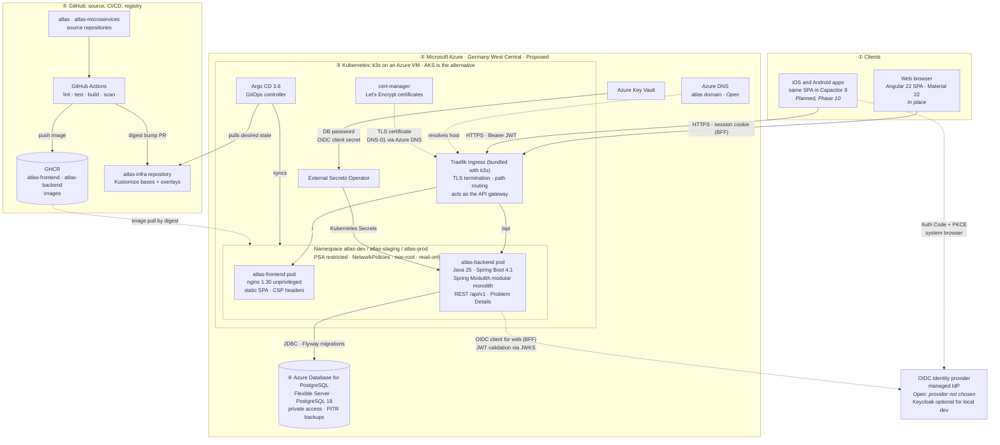
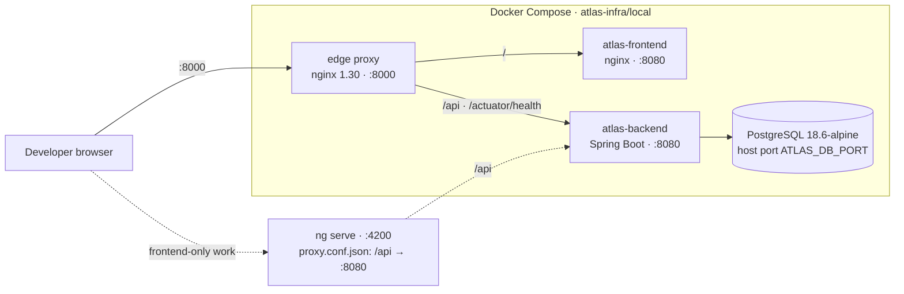

# IKIGAI ATLAS: technical stack and architecture overview

Snapshot after Phase 0 (plans) and Phase 1 (foundations), 2026-11-12. Exact versions and licences are in
[DEPENDENCY-LICENSE-MATRIX.md](DEPENDENCY-LICENSE-MATRIX.md); the C4-style context and delivery views are in
[CONTEXT.md](CONTEXT.md).

**Status legend:** **In place** = built and verified in Phase 1. **Proposed** = ADR written, waiting for the owner.
**Planned** = later phase (see [IMPLEMENTATION-ROADMAP.md](../plan/IMPLEMENTATION-ROADMAP.md)). **Open** = decision
not made yet.

## Architecture graphic (target runtime on Azure)

The production path follows the arrows: clients → Azure edge → Kubernetes pods → managed PostgreSQL. The GitHub
delivery chain and the identity provider are shown at the bottom. A PNG export is in
[tech-stack.png](tech-stack.png); regenerate it when the Mermaid source changes.

### Local development stack (In place)

## Frontend: `atlas`

| Area               | Technology                                                                                      | Version              | Status                                             |
| ------------------ | ----------------------------------------------------------------------------------------------- | -------------------- | -------------------------------------------------- |
| Framework          | Angular: standalone components, signals, zoneless change detection, OnPush                      | 22.2                 | In place                                           |
| Language           | TypeScript · RxJS                                                                               | 6.0 · 7.8            | In place                                           |
| UI components      | Angular Material + CDK, Material 3 theme mapped to Atlas design tokens                          | 22.2                 | In place                                           |
| Icons and fonts    | Tabler Icons · Inter Variable and DM Serif Display (Fontsource, self-hosted)                    | 3.51 · 5.3           | In place                                           |
| Design tokens      | JSON tokens → Node generator → CSS custom properties, SCSS and TS; WCAG contrast gate           | n/a                  | In place                                           |
| Styling            | SCSS (Sass via `@angular/build`), stylelint                                                     | stylelint 17         | In place                                           |
| Build              | Angular CLI, `@angular/build` (esbuild, Vite dev server)                                        | 22.2                 | In place                                           |
| Unit tests         | Vitest + jsdom                                                                                  | 5 · 30               | In place                                           |
| E2E and a11y tests | Playwright + axe-core                                                                           | 1.65 · 4.14          | In place                                           |
| Lint and format    | ESLint + angular-eslint + typescript-eslint · Prettier                                          | 10 · 22.6 · 8.71 · 3 | In place                                           |
| Brand assets       | sharp (raster exports) and an asset validation script                                           | 0.35                 | In place                                           |
| Container          | Build `node:26-alpine` → runtime `nginxinc/nginx-unprivileged:1.30-alpine` (port 8080, UID 101) | 1.30                 | In place                                           |
| Mobile shell       | Capacitor for iOS and Android (`appId` `dev.myatlas.app`)                                       | 8.6                  | Core installed; native projects Planned (Phase 10) |
| API client         | Types generated from the backend OpenAPI document                                               | n/a                  | Planned (Phase 3 spike, D3)                        |
| Visualisation      | ECharts 6 + ngx-echarts, FullCalendar 7 Standard, vis-timeline (spike), d3 only if needed       | n/a                  | Planned (Phase 5)                                  |
| CI                 | GitHub Actions `frontend-ci.yml` and `frontend-container.yml`, Dependabot                       | n/a                  | In place (first GitHub run open)                   |

## Backend: `atlas-microservices`

| Area              | Technology                                                                                      | Version        | Status                                         |
| ----------------- | ----------------------------------------------------------------------------------------------- | -------------- | ---------------------------------------------- |
| Runtime           | Java LTS (Eclipse Temurin), backend ADR-0008                                                    | 25             | In place                                       |
| Framework         | Spring Boot (Spring Framework 7)                                                                | 4.1.2          | In place                                       |
| Architecture      | Spring Modulith modular monolith, one deployable; package `dev.myatlas`                         | 2.1.1          | In place                                       |
| Domain modules    | profile, onboarding, ikigai, goals, dashboard, timeline; later finance, capacity, export, ai    | n/a            | Planned (Phase 3 onwards)                      |
| Web and API       | Spring MVC on Tomcat 11, Jackson 3, Bean Validation; REST `/api/v1`, Problem Details (RFC 9457) | Boot-managed   | Scaffold in place; endpoints Planned (Phase 3) |
| API conventions   | ETag/If-Match, Idempotency-Key, money as string, `PlannedDate`                                  | n/a            | Specified in API-CONTRACT                      |
| Persistence       | Spring Data JPA / Hibernate, HikariCP, PostgreSQL JDBC                                          | 7.4 · 7 · 42.7 | In place                                       |
| Migrations        | Flyway, schema `atlas`                                                                          | 12.4           | In place                                       |
| Database          | PostgreSQL                                                                                      | 18.6           | In place (local and tests)                     |
| Operations        | Spring Boot Actuator (health, liveness, readiness, info), Micrometer, ECS JSON logs             | Boot-managed   | In place                                       |
| Security          | Spring Security OAuth2 resource server (JWT), provider-neutral OIDC                             | Boot-managed   | Proposed (ADR-0005), Planned (Phase 3)         |
| Web session (BFF) | Spring Security OAuth2 client + Spring Session JDBC, `__Host-` cookie                           | Boot-managed   | Planned (Phase 9)                              |
| API documentation | springdoc-openapi, code-first                                                                   | 3.x            | Planned (Phase 4)                              |
| Build             | Maven via wrapper                                                                               | 3.10           | In place                                       |
| Tests             | JUnit, Spring Modulith module verification, Testcontainers (PostgreSQL)                         | 6 · 2.1 · 2.0  | In place                                       |
| Container         | Eclipse Temurin 25 JRE (Ubuntu noble), port 8080, UID 10001                                     | 25.0.5         | In place                                       |
| CI                | GitHub Actions `backend-ci.yml` and `backend-container.yml`                                     | n/a            | In place (first GitHub run open)               |

## Infrastructure and delivery: `atlas-infra`

| Area                | Technology                                                                                                              | Version         | Status                               |
| ------------------- | ----------------------------------------------------------------------------------------------------------------------- | --------------- | ------------------------------------ |
| Manifests           | Kubernetes YAML, Kustomize bases (backend, frontend, ingress, namespace baseline) and dev/staging/prod overlays         | kubectl 1.37    | In place                             |
| Security baseline   | Pod Security Admission `restricted`, default-deny NetworkPolicies, non-root, read-only rootfs, prod PDBs, image digests | n/a             | In place                             |
| GitOps              | Argo CD AppProject + Applications (dev auto-sync; staging and prod manual sync)                                         | 3.6.1           | Manifests in place; cluster Proposed |
| Validation          | kubeconform, yamllint, shellcheck, `scripts/validate.sh`, `manifests-ci.yml`                                            | kubeconform 0.8 | In place                             |
| Local stack         | Docker Compose: PostgreSQL 18.6-alpine, backend, frontend, nginx 1.30 edge proxy                                        | n/a             | In place                             |
| Registry            | GHCR `ghcr.io/hsnrzv/atlas-{frontend,backend}`; build once, promote the digest through bump PRs (GitHub App)            | n/a             | Planned (Phase 2)                    |
| Cloud               | Microsoft Azure, region Germany West Central, budgets and alerts                                                        | n/a             | Proposed                             |
| Compute             | k3s on Azure VM (B2as_v2 for dev + staging; D2as_v5 for prod). Alternatives: AKS, Container Apps                        | k3s 1.37.2      | Proposed (ADR-0003)                  |
| Ingress and gateway | Traefik bundled with k3s: TLS, `/api` → backend, `/` → frontend. No separate API gateway product                        | k3s-bundled     | Proposed                             |
| TLS and DNS         | cert-manager + Let's Encrypt, DNS-01 challenge via Azure DNS                                                            | n/a             | Proposed; domain Open                |
| Database            | Azure Database for PostgreSQL Flexible Server B1ms, private access, point-in-time restore                               | PostgreSQL 18   | Proposed (ADR-0004)                  |
| Secrets             | Azure Key Vault + External Secrets Operator                                                                             | n/a             | Proposed (ADR-0005)                  |
| Identity provider   | Managed OIDC provider; Keycloak optional for local full-stack work                                                      | n/a             | Open                                 |
| Observability       | JSON logs to stdout, metrics-server, Argo CD health, Azure budget alerts; Prometheus deferred                           | n/a             | Proposed                             |
| Mobile release      | GitHub Actions macOS runner → TestFlight / App Store Connect; Android validation workflow                               | n/a             | Planned (Phase 10)                   |

## Runtime contract

| Item     | Value                                                                                                              |
| -------- | ------------------------------------------------------------------------------------------------------------------ |
| Ports    | backend 8080 · frontend container 8080 · PostgreSQL 5432 · `ng serve` 4200 · local edge proxy 8000                 |
| Routing  | Same origin for web: `/api` → backend, `/` → frontend, so no CORS. Native apps need CORS or the native HTTP plugin |
| Env vars | `SPRING_PROFILES_ACTIVE`, `SPRING_DATASOURCE_*`; from Phase 3 `SPRING_SECURITY_OAUTH2_RESOURCESERVER_JWT_*`        |
| Images   | `ghcr.io/hsnrzv/atlas-frontend`, `ghcr.io/hsnrzv/atlas-backend`, deployed by digest                                |
