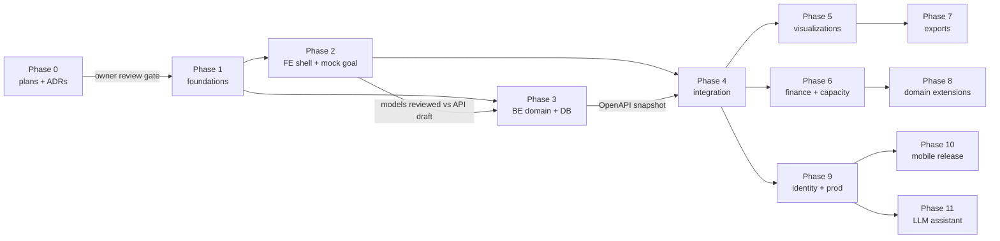

# IMPLEMENTATION-ROADMAP — IKIGAI ATLAS (all repositories)

- Status: **Phase 0 complete, waiting for owner review (plan gate).** Phase 1 foundations are mostly delivered
  (2026-11-12, uncommitted in all three repositories).
- Owner: `atlas` (cross-repository). Repository plans hold the detailed backlogs:
  - [PLAN-FRONTEND](PLAN-FRONTEND.md) (IDs `F…`)
  - `atlas-microservices/docs/plan/PLAN-BACKEND.md` (IDs `BE-…`) and `PLAN-DATABASE.md`
  - `atlas-infra/docs/plan/PLAN-INFRASTRUCTURE-CICD.md` (backlog by phase)
- Rules (`project-instruction.md` §0.1, §18):
  - Implement one phase at a time and do not skip gates.
  - Each backlog item is one reviewable PR that meets the Definition of Done (§19).
  - Update the checkboxes here and in the repository plans as work lands.

## 1. Phase overview and status

| Phase | Goal                                             | `atlas`                                                                        | `atlas-microservices`                                                                            | `atlas-infra`                                                      | Status                                                                      |
| ----- | ------------------------------------------------ | ------------------------------------------------------------------------------ | ------------------------------------------------------------------------------------------------ | ------------------------------------------------------------------ | --------------------------------------------------------------------------- |
| 0     | Plans, ADRs, context, matrices, cost comparison  | PLAN-FRONTEND, CONTEXT, roadmap, license matrix, ADR 0001–0008, `design/` docs | PLAN-BACKEND, PLAN-DATABASE, DOMAIN-MODULES, API-CONTRACT, ADR 0001–0008                         | PLAN-INFRASTRUCTURE-CICD, COST-COMPARISON, ADR 0001–0009, runbooks | ✅ delivered, **awaiting review**                                           |
| 1     | Repository foundations, developer experience     | scaffold, tokens, brand assets, theme, icons, CI, container (F1-1…F1-13)       | Boot 4.1.2 scaffold, Flyway V1, Modulith test, Testcontainers IT, CI, container (BE-1.1…BE-1.11) | local full stack, Kustomize, Argo CD apps, `validate.sh`, CI       | 🟡 mostly done: app shell F1-14, first push and green CI, BE-1.12/1.13 open |
| 2     | Frontend shell and one sample goal (mock-backed) | F2-1…F2-12                                                                     | contract alignment, owner reviews, spikes, GHCR publishing (BE-2.1…2.4)                          | GHCR publishing, bump PRs, owner decisions                         | ⏳                                                                          |
| 3     | Core backend domain and database                 | editing and onboarding UI on the mock, OpenAPI client spike (F3-1…F3-5)        | BE-3.01…BE-3.82                                                                                  | non-prod platform and dev environment                              | ⏳                                                                          |
| 4     | Frontend/backend integration                     | HTTP adapter, states, e2e on the full stack (F4-1…F4-7)                        | BE-4.1…BE-4.6                                                                                    | staging, promotion workflow, e2e in staging                        | ⏳                                                                          |
| 5     | Timeline, calendar, charts                       | visualization spike → wrappers (ADR-0004)                                      | read models if needed                                                                            | —                                                                  | ⏳                                                                          |
| 6     | Finance and time capacity                        | finance and capacity UI                                                        | `finance`, `capacity` modules                                                                    | —                                                                  | ⏳                                                                          |
| 7     | Export system                                    | export UI and renderer (§21.8)                                                 | export data endpoints                                                                            | artifact storage if needed                                         | ⏳                                                                          |
| 8     | Domain extensions                                | per-domain lazy features                                                       | per-domain modules                                                                               | —                                                                  | ⏳                                                                          |
| 9     | Identity hardening and production                | auth flows, licenses page, CSP review                                          | BFF, production IdP, account export/deletion                                                     | prod platform, secrets, backups, TLS                               | ⏳                                                                          |
| 10    | Mobile store release                             | Capacitor iOS/Android projects, plugins                                        | native auth support (CORS/bearer)                                                                | `mobile-validation`, `mobile-release`                              | ⏳                                                                          |
| 11    | LLM planning assistant (post-MVP)                | suggestion review UI                                                           | `ai` module (dry run, audit, approve)                                                            | —                                                                  | ⏳                                                                          |

Phases 2 and 3 can run in parallel once the API draft is reviewed (BE-2.1). Phase 2 is frontend-heavy, Phase 3
backend-heavy.

## 2. Phase gates (exit criteria)

| Phase | Exit criteria (from §18, made measurable)                                                                                                                                                                                  | Evidence                                                                                                                                                                                                                  |
| ----- | -------------------------------------------------------------------------------------------------------------------------------------------------------------------------------------------------------------------------- | ------------------------------------------------------------------------------------------------------------------------------------------------------------------------------------------------------------------------- |
| 0     | All open decisions are listed with recommended defaults (§4 below). The owner has reviewed the plans. No feature code was written.                                                                                         | this document; repository plans; ADR indexes                                                                                                                                                                              |
| 1     | A fresh clone runs locally by following each README. Frontend and backend build and test in CI on GitHub. The backend connects to PostgreSQL through Flyway. The full stack runs locally.                                  | `npm run verify` + `npm run e2e` (atlas); `./mvnw verify` (backend); `scripts/validate.sh` and `docker compose -f local/compose.yaml up --build` all healthy (infra, verified 2026-11-12); first green GitHub runs (open) |
| 2     | Overview → Destination → Waypoint → nested Waypoint and back works. Sample data appears only in development/demo. Smoke tests pass on desktop, tablet and mobile in Chromium, Firefox and WebKit with zero axe violations. | Playwright report (F2-10)                                                                                                                                                                                                 |
| 3     | Domain tests cover hierarchical progress and dependencies. PostgreSQL integration tests pass. The API contract (OpenAPI snapshot) is published. Owner checks are enforced (cross-owner test matrix).                       | `./mvnw verify` (BE-3.80, BE-3.81, BE-3.82)                                                                                                                                                                               |
| 4     | The frontend works against backend and database without demo-only domain data. e2e tests pass in staging.                                                                                                                  | F4-6 in CI; staging run (BE-4.5, infra Phase 4)                                                                                                                                                                           |

## 3. Cross-repository backlog, Phases 1–4 (PR-sized, in dependency order)

`[x]` = delivered in the 2026-11-12 session (uncommitted, verified locally). Details and acceptance criteria are in
each repository plan.

### Phase 1 — foundations

- [x] `atlas` F1-1…F1-13: scaffold, Capacitor config, lint/format, token pipeline + contrast gate, brand assets,
      Material theme, icons, registries, design-foundation page with unit/e2e/axe tests, container + CSP, CI, docs,
      `design/` package.
- [x] `atlas-microservices` BE-1.1…BE-1.11: Boot 4.1.2 scaffold (Java 25 since backend ADR-0008), configuration and profiles, local
      PostgreSQL compose, Flyway V1, `ModularityTests`, Testcontainers IT, Dockerfile, CI, container smoke test,
      hygiene, Phase 0 docs.
- [x] `atlas-infra`: hygiene, local full stack (postgres, backend, frontend, edge) verified end to end, Kustomize
      bases and overlays, Argo CD project and applications (not applied), `validate.sh`, `manifests-ci`, docs.
- [ ] `atlas` **F1-14** responsive app shell with placeholder routes (design step 4). Outstanding §18 Phase 1 item.
- [ ] `atlas-microservices` BE-1.12 JaCoCo report; BE-1.13 SBOM + image scan (scanner chosen with `atlas-infra`).
- [ ] **All repos:** first push, first green CI, branch protection, secret scanning with push protection,
      Dependabot alerts (F1-15, BE-1.14/1.15, infra Phase 1). Owner action.

### Phase 2 — shell content + contract alignment + publishing

1. [ ] Owner review of all `Proposed` ADRs and the decisions in §4 (BE-2.2, infra "owner decisions recorded").
2. [ ] BE-2.1 API draft reviewed against the frontend models planned in F2-2 (A-1…A-6 resolved).
3. [ ] BE-2.3 spike (springdoc with Boot 4.1/Jackson 3; JWT audiences).
4. [ ] F2-1 shared UI primitives → F2-2 models + mock repository → F2-3 My Atlas → F2-4 Destinations → F2-5
       Destination detail → F2-6 Waypoint drill-down → F2-7 Steps → F2-8 Awards → F2-9 Journey list → F2-10 e2e on three
       engines → F2-11 supply-chain gates.
5. [ ] F2-12, BE-2.4 and infra Phase 2: frontend and backend container workflows publish `main-<sha>` to GHCR (SBOM, provenance,
       scan); GitHub App + bump PR to `environments/dev`.

### Phase 3 — backend domain (frontend editing on the mock in parallel)

1. [ ] BE-3.01…3.06 shared types, error model, security baseline with the local development identity, HTTP
       conventions, OpenAPI snapshot, architecture tests.
2. [ ] BE-3.10…3.12 profile and onboarding → BE-3.20 Life Dimensions → BE-3.30/3.31 goals and node tree →
       BE-3.40/3.41 dependencies and unlocks → BE-3.50/3.51 progress and rewards → BE-3.60…3.62 notes, history, links →
       BE-3.70/3.71 timeline and dashboard → BE-3.80…3.82 exit.
3. [ ] F3-1…F3-4 Destination CRUD, nested editing, notes, onboarding (mock); F3-5 client spike on the BE-3.05
       snapshot.
4. [ ] Infra Phase 3: Azure free account, budget and alerts first → k3s VM (B2as_v2) → non-prod PostgreSQL → Key
       Vault + ESO → DNS zones + TLS → `atlas-dev` synced. Platform, database and account are decided
       (`atlas-infra` ADR-0003, 0004, 0009). **Creates paid resources (≈ 61 EUR/month in the free year): needs
       explicit owner approval** and the region confirmed.

### Phase 4 — integration

1. [ ] BE-4.1 `openapi-publish` + breaking-change check → F4-1 typed client + `HttpGoalRepository`.
2. [ ] F4-2 HTTP layer and Problem Details → F4-3 states + ETag/If-Match + idempotency (BE-4.3) → F4-4 flows wired.
3. [ ] F4-5 auth-ready client. BE-4.2 local integration guide with the development identity.
4. [ ] F4-6 e2e against `atlas-infra/local` in CI; F4-7 remove the mock from non-dev builds; BE-4.4 guarded demo
       data switch.
5. [ ] Infra Phase 4 + BE-4.5: staging live, promotion workflow, PostSync smoke, **e2e green in staging**; BE-4.6
       performance check.

**Critical path:** owner review → BE-2.1 → BE-3.0x foundations → BE-3.3x goals/tree → BE-3.82 OpenAPI snapshot →
F4-1 → F4-6 → staging e2e. **Blocking risk (backend R-2):** "e2e in staging" needs authentication. The IdP is decided
(Microsoft Entra External ID, 2026-11-12), but its integration is planned for Phase 9. Either set up the External ID
tenant and the resource-server configuration before Phase 4 staging e2e, or keep staging non-public (allow-listed)
until Phase 9. Never enable the development identity outside `local`.

## 4. Open decisions (consolidated)

Recommended defaults are **proposals** until the owner accepts them. Rows marked **Decided** were accepted by the
owner.

| #   | Decision (§21 ref)                                   | Recommended default                                                                                                                                                                                                                      | Record                                                      | Needed by                               |
| --- | ---------------------------------------------------- | ---------------------------------------------------------------------------------------------------------------------------------------------------------------------------------------------------------------------------------------- | ----------------------------------------------------------- | --------------------------------------- |
| 1   | Identity provider (§21.1)                            | **Decided 2026-11-12:** Microsoft Entra External ID (free up to 50,000 MAU, sign-up disabled); code stays provider-neutral OIDC; Keycloak only as an optional local test IdP                                                             | `atlas-microservices` ADR-0005, B-1; `atlas-infra` ADR-0009 | tenant before Phase 4 staging e2e (R-2) |
| 2   | Kubernetes platform (§21.2)                          | **Decided 2026-11-12:** k3s + Argo CD on one B2as_v2 VM for dev, staging and prod (namespaces; accepted risk). ≈ 61 → 88 EUR/month, with prod ≈ 78 → 105 (free year → after; incl. PostgreSQL and DNS). Own prod VM is the upgrade path. | `atlas-infra` ADR-0003, ADR-0009, COST-COMPARISON           | Phase 3 (infra)                         |
| 3   | Database hosting (§21.3) and backup/restore (§21.11) | **Database decided 2026-11-12:** Azure Database for PostgreSQL Flexible Server B1ms, two servers (non-prod + prod), private. Proposed: PITR 35 days prod; weekly dump; RPO ≤ 5 min, RTO ≤ 4 h target                                     | `atlas-infra` ADR-0004                                      | Phase 3 (infra)                         |
| 4   | Frontend hosting (§21.4)                             | nginx container behind the same Ingress (same origin, Argo CD)                                                                                                                                                                           | `atlas-infra` ADR-0006                                      | Phase 3                                 |
| 5   | Schema strategy (§21.5)                              | one `atlas` schema, module-owned, module-prefixed tables                                                                                                                                                                                 | `atlas-microservices` ADR-0004                              | Phase 3                                 |
| 6   | Progress rules (§21.6)                               | hierarchical weighted average of leaves; skipped and cancelled excluded but reported; partial work only through explicit manual leaf percentages; skipped/cancelled prerequisites satisfy dependencies                                   | backend D-2                                                 | Phase 3 step 5                          |
| 7   | Date precision (§21.7)                               | `PlannedDate {date, precision}` with `DAY`/`MONTH`/`QUARTER`/`YEAR`/`APPROXIMATE`; no "season" in the MVP                                                                                                                                | API-CONTRACT §5, backend D-3                                | Phase 2 (F2-1/F2-2)                     |
| 8   | Export renderer (§21.8)                              | spike in Phase 7 (permissive license; vector PDF + high-resolution raster)                                                                                                                                                               | PLAN-FRONTEND Phase 7                                       | Phase 7                                 |
| 9   | Mobile auth and storage (§21.9)                      | PKCE in the system browser, secure storage plugin, explicit CORS for app origins                                                                                                                                                         | `atlas-microservices` ADR-0005, PLAN-FRONTEND D5            | Phase 10 (design in Phase 9)            |
| 10  | Production secrets (§21.10)                          | External Secrets Operator + Azure Key Vault (workload identity)                                                                                                                                                                          | `atlas-infra` ADR-0005                                      | Phase 3 (infra)                         |
| 11  | Single vs multi-user (§21.12)                        | owner-scoped data model, single-user operation, sign-up restricted at the IdP                                                                                                                                                            | backend B-8                                                 | Phase 3                                 |
| 12  | Visualization stack                                  | ECharts + ngx-echarts; vis-timeline vs native SVG spike; FullCalendar Standard only                                                                                                                                                      | `atlas` ADR-0004                                            | Phase 5                                 |
| 13  | Azure region and subscription type                   | **Account decided 2026-11-12:** free account at Phase 3 start, upgraded to pay-as-you-go within 30 days; budget 75 → 125 EUR. Region: Germany West Central (proposed)                                                                    | `atlas-infra` ADR-0009, COST-COMPARISON                     | Phase 3 (infra)                         |
| 14  | Image publishing, promotion, GHCR visibility         | GHCR, build once, promote the digest; private packages until repository visibility is decided                                                                                                                                            | `atlas-infra` ADR-0007                                      | Phase 2                                 |
| 15  | Migration execution                                  | Flyway at startup until Phase 9, then a PreSync Job with a separate DDL role                                                                                                                                                             | `atlas-infra` ADR-0008, backend B-7                         | Phase 9                                 |
| 16  | API details                                          | archive + permanent `DELETE`; ETag/If-Match; money as a string; `urn:problem:atlas:*`; Spring `PagedModel`; code-first OpenAPI                                                                                                           | API-CONTRACT A-1…A-6                                        | Phase 2 (BE-2.1)                        |
| 17  | Theme preference                                     | follow the system until the user chooses; store only that choice                                                                                                                                                                         | PLAN-FRONTEND D1                                            | F1-14                                   |
| 18  | Frontend API client generation                       | generated types + thin hand-written services                                                                                                                                                                                             | PLAN-FRONTEND D3                                            | Phase 3 (F3-5)                          |
| 19  | PWA/offline                                          | online-only until auth is done (Phase 9)                                                                                                                                                                                                 | PLAN-FRONTEND D6                                            | Phase 9                                 |
| 20  | Domain name and TLS issuer                           | owner-chosen domain (external registrar); Azure DNS public zone + cert-manager DNS-01                                                                                                                                                    | infra plan                                                  | Phase 3 (infra)                         |
| 21  | Repository LICENSE (all three)                       | owner decision; no LICENSE file until then                                                                                                                                                                                               | PLAN-FRONTEND D9; READMEs                                   | before any public release               |
| 22  | Analytics or telemetry                               | none; privacy by default                                                                                                                                                                                                                 | PLAN-FRONTEND D8                                            | —                                       |

## 5. Status log

| Date       | Change                                                                                                                                                                                                                                                                                                                                                                                                                                                                                                                               |
| ---------- | ------------------------------------------------------------------------------------------------------------------------------------------------------------------------------------------------------------------------------------------------------------------------------------------------------------------------------------------------------------------------------------------------------------------------------------------------------------------------------------------------------------------------------------ |
| 2026-11-12 | Phase 0 documents and Phase 1 foundations created in all three repositories (uncommitted). Verified locally: atlas `verify` + e2e (10/10, zero axe violations) and the container smoke tests; backend `./mvnw verify` (modularity tests + 7 Testcontainers ITs on PostgreSQL 18.6), container health check and `spring-boot:run` with the local profile; infra `validate.sh` (kubeconform 45/45) and the full-stack compose with both real Dockerfiles.                                                                              |
| 2026-11-12 | Owner decision: the backend moves from Java 21 to **Java 25 LTS** (backend ADR-0008; Temurin 25 supported until 2031-09-30). Re-verified: `./mvnw verify` on JDK 25, image on `eclipse-temurin:25-jre-noble` (Temurin 25.0.5, UID 10001), full local stack healthy. The Temurin 25 image has no `curl`/`wget`, so the local Compose backend health check now uses bash `/dev/tcp`; Kubernetes probes (`httpGet`) are unaffected. Added `docs/architecture/TECH-STACK.md` with the architecture graphic.                              |
| 2026-11-12 | Owner decisions on the Azure free-service lists (`atlas-infra` ADR-0009): identity provider **Microsoft Entra External ID** (decision #1; Azure AD B2C is closed to new customers); **k3s + Argo CD on one B2as_v2 VM** with prod as a namespace from Phase 9 (#2, ADR-0003 amended); **two PostgreSQL B1ms servers** (#3, ADR-0004); **free account → pay-as-you-go** (#13). Expected cost ≈ 61 → 88 EUR/month (Phases 3–8) and ≈ 78 → 105 (with prod), free year → after. Final service list in `docs/architecture/TECH-STACK.md`. |
